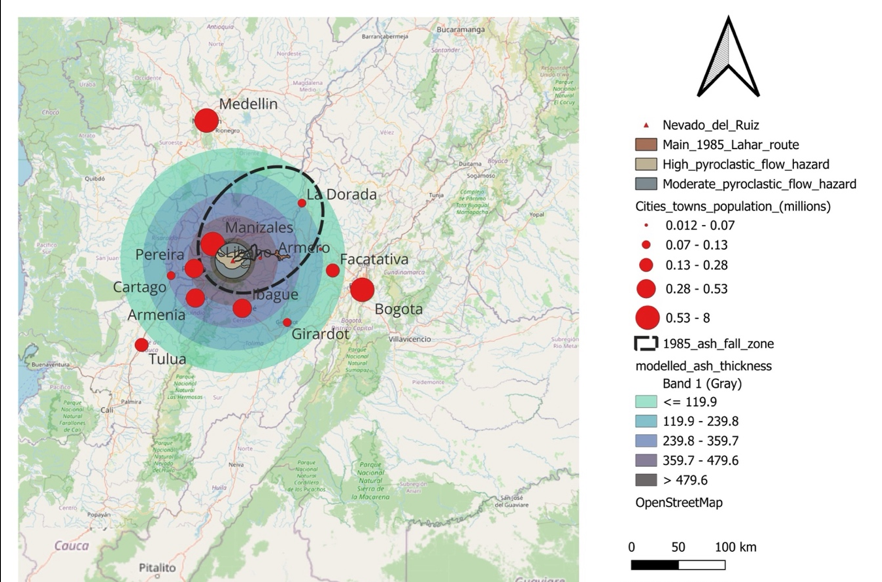
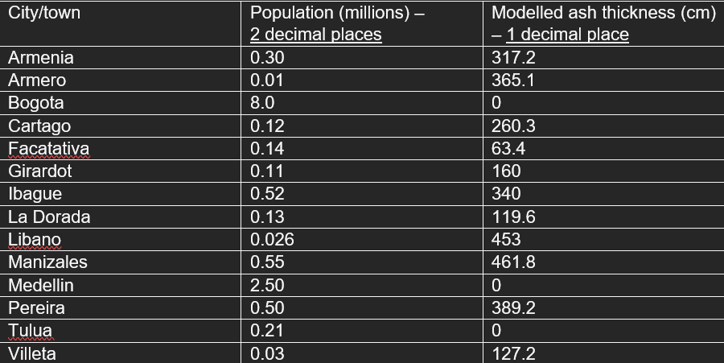

# Volcanic-hazard-map
A volcanic hazard map to show the impacts of Nevado-del-Ruiz on surrounding populated areas 

# Why I made it
I wanted to use spatial data to investigate the impact of the 1985 eruption of Nevado-del-Ruiz. I wanted to visualize the effects of lahars, pyroclastic flows and ash fall on surrounding populated areas using geospatial technology. 
# Tools and methods
- Information: Data relating to the 1985 Nevado del Ruiz eruption
- Background map: OpenStreetView
- Tools: QGIS
# Results
Table to show poulation and modelled ash thickness data for towns and cities surrounding Nevado del Ruiz:

The main areas effected by ash thickness are Manizales, Armero, Pereira and Libanos. These areas experienced 359.7 – 479.6mm of ash thickness. These areas would have experienced large amounts of air pollution and therefore making it an extremely high risk and hazardous area during the time of eruption. 
As we move out, we see that areas such as Cartago, Armenia and Ibague fall into the 239.8 – 359.7mm category of ash thickness. Girardot and Viletta experienced values within 119.9 – 239.8mm with Facatativa experiencing less than or equal to 119mm of ash thickness. The area surrounding Nevado del Ruiz itself experienced the thickest ash, measuring values greater than 479.6mm but no immediate cities or towns fall in this category despite some being close.
Bogota, Tulua and Medellin are all located outside of the ash zone, not meeting the minimum threshold of ash thickness to be mapped. A clear pattern showed by map one is that the further away the city or town is from the eruption, the less ash thickness it accumulates.
